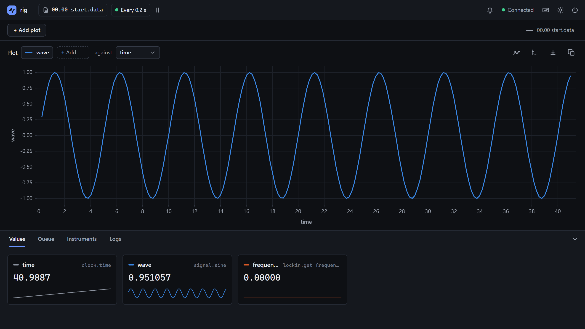
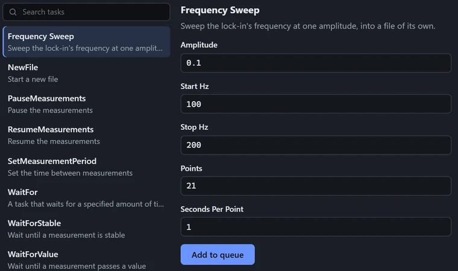

# 2. The Config File

<p class="pa-meta" markdown="span">About 10 minutes · Needs [1. Installation](installation.md)</p>

An experiment in PyAcquisition is made of **instruments**, the things it reads from and controls, and **measurements**, the values it reads from them, over and over, as it runs. From those it makes the rest: the interface, a data file with a column for each measurement, and a log.

All of that can be described in one small file. It is written in [TOML](https://toml.io/en/), a simple format: `[tables]`, each with `key = value` lines under it. In this part you build the file a few lines at a time. There is no Python to write and nothing to plug in, since every instrument here is a software one or a stand-in for the real thing. Keep the `my-lab` project from [installation](installation.md) open in your editor, and follow along: the file runs after every step.

<div class="gs" markdown>

<div class="gs-stage" markdown>

<div class="gs-notes" markdown>

<section class="gs-step" data-new-file data-result="The interface opens, with nothing in it yet." markdown>

## Start with an empty file

Make an empty file in `my-lab` called `rig.toml`, and run it:

```bash
uv run pyacquisition --toml rig.toml
```

`pyacquisition --toml` runs the experiment a file describes, and an empty file is already one. The window opens, titled `rig` after the file, with nothing in it yet, and the terminal logs what the experiment is doing.

It makes a `data` folder for its data files, and a `logs` folder too. Close the window, and choose **Stop experiment**.

**More:** [a tour of the window](../reference/interface.md), and [everything a config file can say](../reference/config_file.md).
{ .gs-more }

</section>

<section class="gs-step" markdown>

## Add an instrument: a clock

```toml
[instruments]
clock = { instrument = "Clock" }
```

`[instruments]` is a table of the experiment's instruments, one to a line.

On the left, `clock` is the instrument's name: yours to choose, and how the rest of the file refers to it. `instrument = "Clock"` names its **driver**, the code that knows how to talk to it. `Clock` is a *software* instrument, which runs on your computer, so there is nothing to connect.

An instrument has **queries**, values it can be asked for, and **commands**, which change it. The clock's `time` query is the seconds since it was made.

**More:** [every driver](../reference/instruments/overview.md), and [the `[instruments]` table](../reference/config_file.md#instruments).
{ .gs-more }

</section>

<section class="gs-step" markdown>

## Add a measurement: time

```toml
[measurements]
time = { instrument = "clock", method = "time" }
```

`[measurements]` is a table of what to record, one measurement to a line. Each names an instrument, and a `method`: one of its queries, here the clock's `time`. The name on the left, also `time`, is the measurement's own, and its column's in the data file.

The experiment **polls** its measurements: once a cycle, over and over, it reads each of them. Every reading is a live value in the window, a point you can plot, and an entry in the data file.

**More:** [the Clock's queries](../reference/instruments/clock.md), and [the `[measurements]` table](../reference/config_file.md#measurements).
{ .gs-more }

</section>

<section class="gs-step" markdown>

## Add a measurement with arguments

```toml
[instruments]
signal = { instrument = "SignalGenerator" }

[measurements]
wave = { instrument = "signal", method = "sine", args = { frequency = 0.2 } }
```

Some queries take arguments. A `SignalGenerator` is another software instrument, which makes waveforms from the time, and its `sine` query takes a `frequency`, an `amplitude`, a `phase` and an `offset`, each with a default.

`args` gives a query its arguments, as a table of names and values. Here the `wave` measurement asks for a `frequency` of 0.2 Hz, one cycle every five seconds, and the rest keep their defaults.

Add each line under its table. A table can only appear once in a file, so the tables are shown here only to say where the lines go.

**More:** [the Signal Generator's waveforms and their arguments](../reference/instruments/signal_generator.md), and [queries with arguments](../usage/measurements.md#pass-a-choice-the-input-channel).
{ .gs-more }

</section>

<section class="gs-step" markdown>

## Change the polling period

```toml
[rack]
period = 0.2
```

The **rack** is the part of the experiment that polls the measurements, and `[rack]` sets its options.

`period` is the polling period: the time from the start of one cycle to the start of the next, in seconds. It is 0.25 unless you say otherwise, and a cycle that takes longer delays the next. `0.2` polls five times a second, so the data file gains five rows a second.

**More:** [the `[rack]` table](../reference/config_file.md#rack), and [how long the cycles really take](../reference/interface.md#the-top-bar).
{ .gs-more }

</section>

<section class="gs-step" markdown>

## Add a hardware instrument

```toml
[instruments.lockin]
instrument = "SR_830"
adapter = "mock"
resource = "GPIB0::8::INSTR"

[measurements]
frequency = { instrument = "lockin", method = "get_frequency" }
```

A *hardware* instrument is a device that the computer talks to, here a Stanford Research SR830 lock-in amplifier, whose driver is `SR_830`. It needs two keys that a software one doesn't: an `adapter`, how the computer reaches it, and a `resource`, its address.

The `mock` adapter stands in for the device, answering each query with the value last set, or 0. So the driver runs without one, and its queries and commands are all in the interface's **Instruments** tab to try.

A hardware instrument is measured like any other: `frequency` records the lock-in's reference frequency, which reads 0 until something sets it, as part 3 does.

??? tip "Have a real SR830 connected?"
    Use it instead: set `adapter = "pyvisa"`, and `resource` to its address, such as `GPIB0::8::INSTR` at GPIB address 8. Through a Prologix GPIB-USB controller, it is `adapter = "prologix"`, with the port and the GPIB address as the resource, such as `COM3::8`.

    Any other instrument with a driver connects the same way.

`[instruments.lockin]` is the same as a line under `[instruments]`, as a table of its own because it is longer.

**More:** [the SR 830](../reference/instruments/sr_830.md), [the `mock` adapter](../reference/adapters.md#mock), [finding an instrument's address](../usage/connect_instrument.md#find-the-instruments-address), [a Prologix controller](../reference/adapters.md#prologix), and [installing a VISA library](../usage/connect_instrument.md#a-visa-library-for-gpib) for GPIB.
{ .gs-more }

</section>

<section class="gs-step" data-result="Recording every 0.2 s to data/01.00 start.data" markdown>

## Run the experiment

```bash
uv run pyacquisition --toml rig.toml
```

The same command as before, now with the whole rig. The experiment polls the measurements every 0.2 s, and writes each cycle as a row of a data file in `data`, with a column for each measurement.

Each run starts a new data file, numbered on from those already there, so that none is overwritten: after the empty file's `00.00 start.data`, this one is `01.00 start.data`. That is a whole experiment, in sixteen lines.

**More:** [data files and their names](../reference/data_files.md), and [reading your data](../usage/read_data.md).
{ .gs-more }

</section>

</div>

</div>

</div>

<div class="gs-finish" markdown>

<div class="gs-finish__head" markdown>

Part 2 of 3 done
{ .gs-finish__eyebrow }

[Installation](installation.md){ .is-done } [The Config File](config_file.md){ .is-done } [The Python API](python_api.md)
{ .gs-progress }

</div>

## A whole experiment, in 16 lines

<div class="gs-finish__part" markdown>

You wrote
{ .gs-finish__label }

```toml title="rig.toml"
[instruments]  # (6)
clock = { instrument = "Clock" }
signal = { instrument = "SignalGenerator" }

[instruments.lockin]
instrument = "SR_830"
adapter = "mock"
resource = "GPIB0::8::INSTR"

[measurements]  # (4)
time = { instrument = "clock", method = "time" }
wave = { instrument = "signal", method = "sine", args = { frequency = 0.2 } }
frequency = { instrument = "lockin", method = "get_frequency" }

[rack]
period = 0.2  # (2)
```

No Python, and one command runs it: `uv run pyacquisition --toml rig.toml`. [Config file](../reference/config_file.md) lists every option it can take, and `uv run pyacquisition new rig.toml` writes it from forms ([Build a config in the interface](../usage/setup_page.md)).
{ .gs-finish__aside }

</div>

<div class="gs-finish__part" markdown>

You got
{ .gs-finish__label }

<div class="gs-shot" markdown>

{ .pa-shot }

<span class="gs-pin" style="--x: 19.1%; --y: 3%">1</span>
<span class="gs-pin" style="--x: 26.1%; --y: 3%">2</span>
<span class="gs-pin" style="--x: 28.7%; --y: 16%">3</span>
<span class="gs-pin" style="--x: 60.7%; --y: 81%">4</span>
<span class="gs-pin" style="--x: 7.9%; --y: 69.4%">5</span>
<span class="gs-pin" style="--x: 14%; --y: 69.4%">6</span>
<span class="gs-pin" style="--x: 19.7%; --y: 69.4%">7</span>

</div>

<div class="gs-legend" markdown>

1. **A data file**, in `data`. Every row, saved as it is measured, a column for each measurement. Each run starts a new one.
2. **Every 0.2 s**, the `period` from `[rack]`. The button beside it pauses polling.
3. **A live plot.** Any measurement against any other.
4. **A tile for each measurement**, with its latest reading.
5. **A queue**, for waits and new files, and in part 3, a sweep of your own.
6. **Each instrument's controls.** Every query and command, to send by hand. The lock-in is a stand-in until you give it a real `adapter`.
7. **A log** of everything the experiment does, also saved in `logs`.

</div>

</div>

??? pa-stuck "Stuck?"
    - **`Cannot declare ('instruments',) twice`.** A table appears twice. Put the new lines under the `[instruments]` or `[measurements]` you already have, or copy the whole file above.
    - **`rig.toml has 1 problem`.** The file is checked before anything starts, and every mistake in it is listed, naming the instrument or measurement it's in. A misspelt driver is given the closest name, as in `there is no driver called 'signalgenerator' (did you mean 'SignalGenerator'?)`, since names are case sensitive. The [Instruments](../reference/instruments/overview.md) pages list them.
    - **A real instrument is missing from the Instruments tab.** An instrument that can't be opened, at a wrong address say, is skipped with a warning in the log, and the rest of the experiment still starts. Check its address, and that a VISA library is installed for GPIB.
    - **No window appears.** Look at the terminal for an error. The page is also at [http://localhost:8000](http://localhost:8000) in a browser.

</div>

<div class="gs-next" markdown>

<div class="gs-next__text" markdown>

Next · about 20 minutes
{ .gs-next__eyebrow }

[3. The Python API](python_api.md)
{ .gs-next__title }

Keep `rig.toml` as it is, and add a short Python file: the lock-in set up as the experiment starts and left safe as it ends, a calculated column, and a frequency sweep of your own, queued from a form in the interface that you don't write.

</div>



</div>
