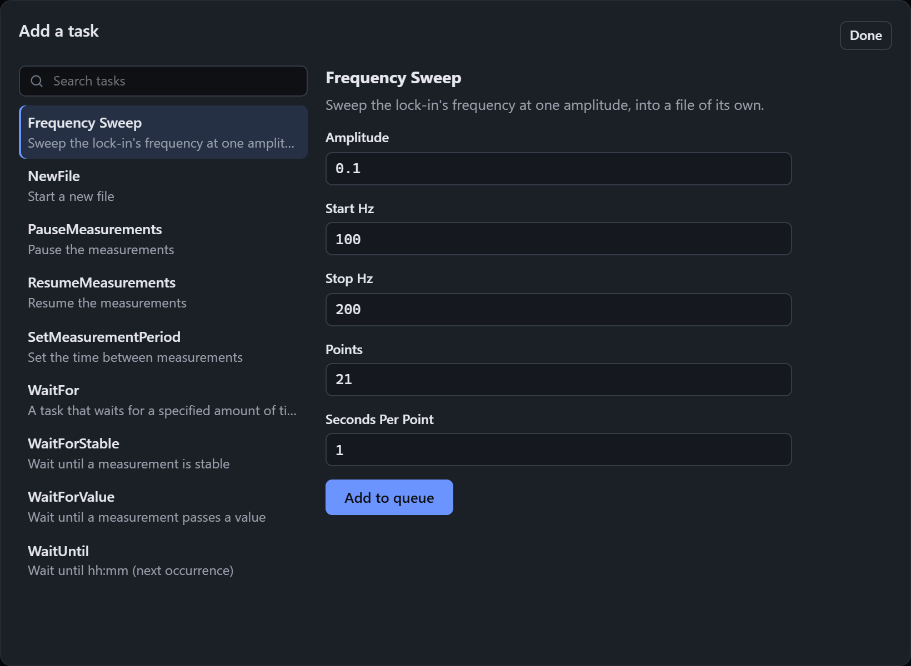
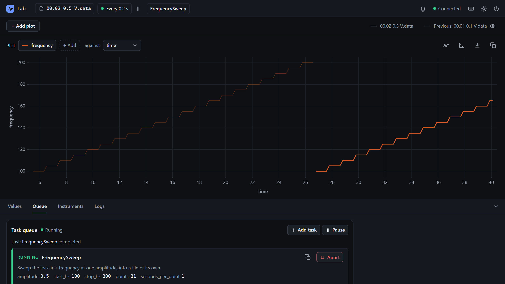

# 3. The Python API

<p class="pa-meta" markdown="span">About 20 minutes · Needs [2. The Config File](config_file.md), and a little Python</p>

A config file says what the rig is, but not what to do with it. That part is Python: putting the instruments into a known state as the experiment starts, and leaving them safe as it ends, working out new columns from each row as it is recorded, and procedures that the experiment runs for you. In this part you keep `rig.toml` as it is, and build a short Python file beside it, a few lines at a time.

You need only a little Python: a class with a few methods, and a `for` loop. Anything more is explained as it comes.

<div class="gs" data-mode="versions" data-file="lab.py" data-lines="20" data-term-lines="4" markdown>

<div class="gs-stage" markdown>

<div class="gs-notes" markdown>

<section class="gs-step" data-new-file data-result="The same interface, now called Lab." markdown>

## Running from Python

Make a file called `lab.py` beside `rig.toml`, and run it:

```python title="lab.py"
--8<-- "examples/getting_started/lab_1.py"
```

```bash
uv run lab.py
```

`Lab` is your experiment. It is a kind of `Experiment`, PyAcquisition's class for one, and adds nothing of its own yet. `Lab.from_config("rig.toml")` makes a `Lab` with the file's instruments and measurements, and `.run()` starts it, as `pyacquisition --toml` did.

The window is the same, but titled `Lab`, after the class. Keep `.run()` under `if __name__ == "__main__":`. The interface starts by importing this file again, and without that line it would start a second experiment.

**More:** [combining a config file with Python](../reference/experiment_options.md#where-a-value-comes-from), and [setting the experiment's options](../usage/options.md) in the class.
{ .gs-more }

</section>

<section class="gs-step" markdown>

## Experiment setup

```python title="lab.py" hl_lines="7 8 9"
--8<-- "examples/getting_started/lab_2.py"
```

`setup()` is a method of every experiment, which does nothing until you write your own. The experiment calls it once, as `.run()` starts, before the first measurement is read. By then the file's instruments are made, and `self.instruments` has them under the names `rig.toml` gave them.

An instrument's queries and commands are methods you can call. The file says there is a lock-in, but not what state to put it in, so this `setup()` sets its reference frequency to 137 Hz, and every run starts from the same settings. Once it runs, the `frequency` tile reads `137`, since the `mock` adapter answers with the value last set.

**More:** [`setup()`](../reference/python_api/experiment.md#pyacquisition.core.experiment.Experiment.setup), and [the SR 830's commands](../reference/instruments/sr_830.md).
{ .gs-more }

</section>

<section class="gs-step" markdown>

## Experiment teardown

```python title="lab.py" hl_lines="11-14"
--8<-- "examples/getting_started/lab_3.py"
```

`teardown()` is `setup()`'s partner: the experiment calls it once as it ends, after its window has closed but while the instruments are still open. It is the place to leave them safe, and it runs however the experiment ends, even after an error.

The lock-in's sine output drives whatever it is wired to, and would go on doing so after the experiment. So this `teardown()` turns it down to 4 mV, the least an SR830 gives, and says so. When you stop the experiment, the line is among the last in the terminal.

**More:** [`teardown()`](../reference/python_api/experiment.md#pyacquisition.core.experiment.Experiment.teardown), and [the SR 830's commands](../reference/instruments/sr_830.md).
{ .gs-more }

</section>

<section class="gs-step" markdown>

## Add calculations

```python title="lab.py" hl_lines="11"
--8<-- "examples/getting_started/lab_4.py"
```

A **calculation** makes new columns from each row as it is recorded. This one is a function of the row, a `dict` of column names to values, and returns the new column: `power`, the square of `wave`.

The new columns are saved beside the measurements in the data file, and can be plotted like them. A function of your own can only be written in Python, so it is added in `setup()`. The ready-made calculations, such as a rolling mean, can also go in the file.

**More:** [calculations](../usage/calculations.md), and [the ready-made ones](../reference/calculations.md).
{ .gs-more }

</section>

<section class="gs-step" markdown>

## Create a task

```python title="lab.py" hl_lines="1 3 6-8 10-11"
--8<-- "examples/getting_started/lab_5.py"
```

A **task** is a procedure that the experiment runs for you, from its queue, while it goes on measuring: a sweep, a wait, a set of files. Many come with PyAcquisition, and your own can run them in turn.

A task is a class: a `dataclass` of `Task`, with a docstring that says what it does, and a `run()` method that does it. `run()` is the one method a task must have, and this one does nothing yet: `pass` is Python for an empty body.

**More:** [Write a task](../usage/write_task.md), and [`Task`](../reference/python_api/task.md), with the other methods a task can have.
{ .gs-more }

</section>

<section class="gs-step" markdown>

## Give the task inputs

```python title="lab.py" hl_lines="10-14"
--8<-- "examples/getting_started/lab_6.py"
```

A task's fields are its inputs, each with a type and a default. The interface asks for them in a form, a box for each, filled in with its default, and checks that each is a number of the right kind before the task is queued.

This sweep's are the lock-in's output amplitude, in volts, the frequencies to start and stop at, how many points to take from one to the other, and how long to stay at each. In `run()` they are `self.amplitude`, `self.start_hz`, and so on.

**More:** [inputs, and the form made from them](../usage/write_task.md#write-a-task-with-inputs).
{ .gs-more }

</section>

<section class="gs-step" markdown>

## Sweep the frequency

```python title="lab.py" hl_lines="17-22"
--8<-- "examples/getting_started/lab_7.py"
```

`run()` is called with the experiment, so a task finds its instruments as `setup()` does. This one sets the lock-in's output to the amplitude, then steps its frequency from `start_hz` to `stop_hz`: `points` frequencies, `step` apart, staying `seconds_per_point` at each while the experiment records.

`run()` is `async`, and `self.sleep()` is awaited, so that while the task waits, the experiment goes on measuring, and the task can be paused or aborted there. With a real lock-in, give each point a few of its time constants, for its reading to settle.

**More:** [`sleep()`](../reference/python_api/task.md#pyacquisition.core.task_manager.task.Task.sleep), and [the SR 830's commands](../reference/instruments/sr_830.md).
{ .gs-more }

</section>

<section class="gs-step" markdown>

## A file for each sweep

```python title="lab.py" hl_lines="4 20-21 26"
--8<-- "examples/getting_started/lab_8.py"
```

Each sweep goes into a data file of its own, named after its amplitude, so that the files are easy to tell apart. `NewFile` is one of the ready-made tasks, and `run_subtask()` runs it until it finishes, once the lock-in is at the sweep's first frequency. `self.log()` writes a line to the **Logs** tab as the sweep ends.

To sweep at three amplitudes, you queue the task three times, each with its own amplitude. Each is a task of its own, which waits its turn.

**More:** [what `run_subtask()` does](../reference/python_api/task.md#pyacquisition.core.task_manager.task.Task.run_subtask), and [every ready-made task](../reference/tasks/overview.md), such as [NewFile](../reference/tasks/new_file.md).
{ .gs-more }

</section>

<section class="gs-step" markdown>

## Register your task

```python title="lab.py" hl_lines="37"
--8<-- "examples/getting_started/lab_9.py"
```

A task you write isn't offered anywhere until it is registered. `register_task`, in `setup()`, lists it in the interface's **Add task**, with its docstring as its description, and a form made from its fields: a box for each, filled in with its default.

`label` is the name it is listed under, **Frequency Sweep**. Without one, it is the class's name.

**More:** [registering tasks](../reference/python_api/experiment.md#pyacquisition.core.experiment.Experiment.register_task), and [Write a task](../usage/write_task.md), for one of your own that drives hardware.
{ .gs-more }

</section>

<section class="gs-step" data-result="Frequency Sweep is in Add task. Queue it." markdown>

## Run the experiment

```bash
uv run lab.py
```

A running experiment doesn't see changes to its file, so stop the one from the first step if it is still open, and run it again.

In the **Queue** tab, choose **Add task**, then **Frequency Sweep**, and **Add to queue**. Then change **Amplitude** to `0.5` and add it again, and to `1` for a third. The first starts at once, and the others wait their turn: three sweeps from 100 to 200 Hz, 21 s each. Plot `frequency` against `time` to watch each one step up.

Each sweep is a data file of its own, named after its amplitude, and numbered on from this run's first: `03.01 0.1 V.data` after `03.00 start.data`, if you have run every step. Each has a `frequency` column, and `power` beside `wave`.

When they are done, close the window and choose **Stop experiment**. `teardown()` runs, and the terminal says `The lock-in's output is turned down.`

**More:** [the queue](../usage/queue.md), and [pausing, resuming and aborting a task](../usage/queue.md#pause-resume-and-abort).
{ .gs-more }

</section>

</div>

</div>

</div>

<div class="gs-finish" markdown>

<div class="gs-finish__head" markdown>

Part 3 of 3 done
{ .gs-finish__eyebrow }

[Installation](installation.md){ .is-done } [The Config File](config_file.md){ .is-done } [The Python API](python_api.md){ .is-done }
{ .gs-progress }

</div>

## Your own sweep, from one Python file

<div class="gs-finish__part" markdown>

You wrote
{ .gs-finish__label }

```python title="lab.py"
from dataclasses import dataclass

from pyacquisition import Experiment, Task
from pyacquisition.tasks import NewFile


@dataclass
class FrequencySweep(Task):  # (4)
    """Sweep the lock-in's frequency at one amplitude, into a file of its own."""

    amplitude: float = 0.1  # volts
    start_hz: float = 100.0
    stop_hz: float = 200.0
    points: int = 21
    seconds_per_point: float = 1.0

    async def run(self, experiment):
        lockin = experiment.instruments["lockin"]
        lockin.set_reference_amplitude(self.amplitude)
        lockin.set_frequency(self.start_hz)
        await self.run_subtask(NewFile(file_name=f"{self.amplitude:g} V"))  # (5)
        step = (self.stop_hz - self.start_hz) / (self.points - 1)
        for i in range(self.points):
            lockin.set_frequency(self.start_hz + i * step)
            await self.sleep(self.seconds_per_point)
        self.log(f"Swept at {self.amplitude:g} V")


class Lab(Experiment):
    """The rig is in rig.toml. What a file can't say goes here."""

    def setup(self):  # (1)
        lockin = self.instruments["lockin"]
        lockin.set_frequency(137.0)

        self.add_calculation(lambda row: {"power": row["wave"] ** 2})  # (3)
        self.register_task(FrequencySweep, label="Frequency Sweep")

    def teardown(self):  # (2)
        lockin = self.instruments["lockin"]
        lockin.set_reference_amplitude(0.004)
        print("The lock-in's output is turned down.")


if __name__ == "__main__":
    Lab.from_config("rig.toml").run()
```

Beside `rig.toml` from part 2, as it was, and run with `uv run lab.py`. There is no interface code in it: the window makes its form from the task's fields.
{ .gs-finish__aside }

</div>

<div class="gs-finish__part" markdown>

You got
{ .gs-finish__label }

<div class="gs-finish__shots" markdown>

[{ .pa-shot }](../images/getting_started/add-task.png)

[{ .pa-shot }](../images/getting_started/sweep-running.png)

</div>

<div class="gs-legend" markdown>

1. **A known start.** The lock-in at 137 Hz whenever the experiment starts: its `frequency` tile reads 137.
2. **A safe end.** Its output turned down as the experiment stops, however it stops.
3. **A new column**, `power`, worked out from each row and saved beside the rest.
4. **Frequency Sweep in Add task**, with a form made from its fields. Queue it once for each amplitude you want.
5. **A file for each sweep**, named after its amplitude: `0.1 V`, `0.5 V` and `1 V`.

</div>

</div>

??? pa-stuck "Stuck?"
    - **The experiment stops as it starts, with `Task group terminated due to an error: 'lockin'`.** The name in quotes isn't in `self.instruments`, which has the names that `rig.toml` gives the instruments. `self.instruments["lockin"]` needs the `[instruments.lockin]` table from part 2 in the file, spelt the same.
    - **Frequency Sweep isn't in Add task.** Run `uv run lab.py`, not `uv run pyacquisition --toml rig.toml`: the file on its own doesn't know about your task. Then check the `register_task` line.
    - **An error about a new process and bootstrapping (Windows).** `.run()` is not under the `if __name__ == "__main__":` line.

</div>

## What next?

<div class="gs-goals" markdown>

I want to…
{ .gs-finish__label }

- [Connect my instrument](../usage/connect_instrument.md)

    Put your lock-in, or any instrument with a driver, in place of the stand-in.

- [Read my data](../usage/read_data.md)

    Into pandas, and into figures, with a script the interface writes for you.

- [Sweep a temperature](../usage/sweep.md)

    Step a cryostat through temperatures, a file at each, with an interlock.

- [Write a driver](../usage/hardware_instrument.md)

    For an instrument PyAcquisition doesn't know yet, from its manual.

- [Calculate new columns](../usage/calculations.md)

    Smooth a noisy signal, or work out a column from others, as you record.

- [Give my lab an app](../usage/standalone_app.md)

    One file to double-click, on a PC with no Python.

</div>

Everything else is in [Usage](../usage/index.md), a topic to a page.
{ .gs-goals__more }
