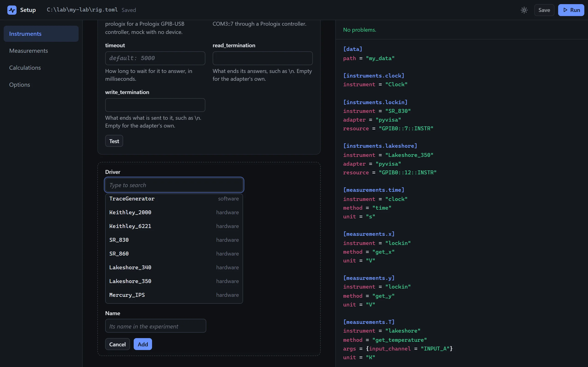
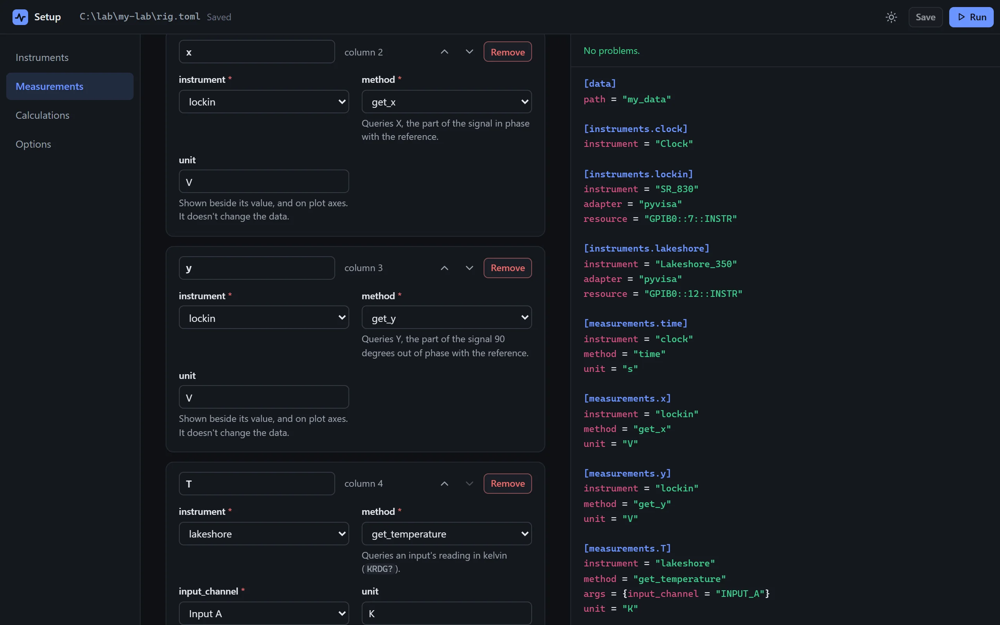
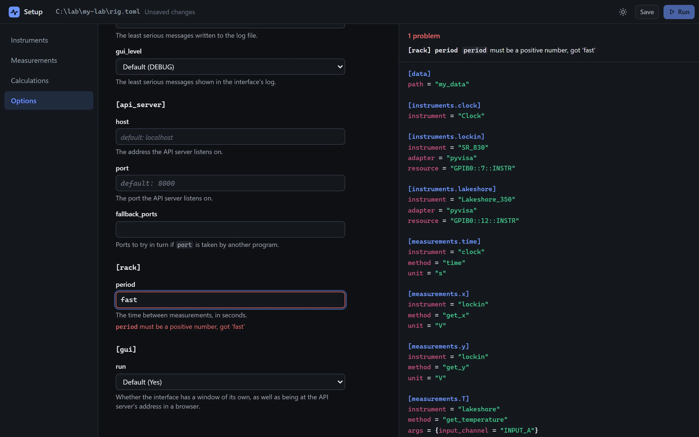

---
hide:
  - navigation
  - toc
  - path
---

<div class="pa-hero pa-live" markdown>

<div class="pa-aurora" aria-hidden="true" markdown="0"><i></i><i></i><i></i></div>

<div class="pa-live__head" markdown>

<p class="pa-eyebrow">Python · Lab automation</p>

# Write only the science.<br><span class="pa-gradient">The rest is built for you.</span>

<p class="pa-lede">PyAcquisition turns a short Python script into a complete lab application: instrument control, scheduled measurements, data files, automated tasks and a live interface.</p>

<div class="pa-live__actions" markdown>

[Get started](getting_started/installation.md){ .md-button .md-button--primary } <a class="md-button pa-glass" href="demo/">Try it live</a>

<div class="pa-install" markdown>

```
uv add pyacquisition
```

</div>

</div>

</div>

<div class="pa-stage" markdown>

<div class="pa-stage__bar" markdown="0"><span class="pa-stage__lights" aria-hidden="true"><i></i><i></i><i></i></span><span class="pa-stage__title">MyExperiment</span><span class="pa-window__label">Simulated instruments</span></div>

<div class="pa-ide pa-stage__code" markdown>

```python title="my_experiment.py"
--8<-- "examples/front_page.py"
```

</div>

<div class="pa-stage__app" markdown="0"><div class="pa-window"><div class="pa-window__view"><iframe src="demo/" title="The interface the script beside it makes, running with simulated instruments"></iframe></div></div></div>

</div>

<p class="pa-stage__note" markdown="0">The interface is real: the readings come from a simulated sample. <a href="demo/">Open it full size</a></p>

</div>

<div class="pa-section pa-showcase" markdown>

## Prefer a config file?

The same experiment, declared in TOML, with no Python to write.

<div class="pa-annot" data-source="examples/front_page.toml" markdown>

<div class="pa-ide" markdown>

```toml title="rig.toml" linenums="1" hl_lines="1-2 4-15 17-30 32-36"
--8<-- "examples/front_page.toml"
```

</div>

<div class="pa-annot__notes" markdown="0">
<div class="pa-note" style="--from: 1; --to: 2" data-contains="[data]"><b>Set options</b><span>Where the data files go, and any other option.</span></div>
<div class="pa-note" style="--from: 4; --to: 15" data-contains="Lakeshore_350"><b>Add instruments</b><span>A class name, and for hardware an adapter and an address. The key is the instrument's id.</span></div>
<div class="pa-note" style="--from: 17; --to: 30" data-contains="get_x"><b>Add measurements</b><span>An instrument and one of its queries, read every cycle and saved to the data file, with a unit for the interface.</span></div>
<div class="pa-note" style="--from: 32; --to: 36" data-contains="args"><b>With arguments</b><span><code>args</code> gives a query its arguments. An enum member is named as text.</span></div>
</div>

</div>

<div class="pa-flow" markdown="0"><span class="cmd"><b>$</b> uv run pyacquisition --toml rig.toml</span></div>

</div>

<div class="pa-section pa-setup" markdown="0">
<p class="pa-kicker">No code at all</p>
<h2 id="build-it-in-a-window">Or build it in a window.</h2>
<p class="pa-setup__lede">One command opens a page of forms that writes the file above for you, and checks it as you type.</p>
<p class="pa-setup__cmd"><code><b>$</b> uv run pyacquisition new rig.toml</code></p>
<div class="pa-switch">
<div class="pa-switch__list" role="tablist" aria-label="The setup page">
<button class="pa-switch__tab" type="button" role="tab" id="pa-setup-tab-1" aria-controls="pa-setup-shot-1" aria-selected="true"><b>Pick your instruments</b><span>Choose a driver from the list, and give it an adapter and an address. <em>Test</em> asks the instrument who it is.</span><i class="pa-switch__bar" aria-hidden="true"></i></button>
<button class="pa-switch__tab" type="button" role="tab" id="pa-setup-tab-2" aria-controls="pa-setup-shot-2" aria-selected="false" tabindex="-1"><b>Choose what to measure</b><span>Any query of the instrument's driver, with a field for each argument and its choices, and a unit for the plots.</span><i class="pa-switch__bar" aria-hidden="true"></i></button>
<button class="pa-switch__tab" type="button" role="tab" id="pa-setup-tab-3" aria-controls="pa-setup-shot-3" aria-selected="false" tabindex="-1"><b>Checked as you type</b><span>The file is written beside the forms as you go, and anything wrong is named before you run it. A file you open keeps its comments and order.</span><i class="pa-switch__bar" aria-hidden="true"></i></button>
</div>
<div class="pa-switch__view">
<div class="pa-device">



</div>
</div>
</div>
<p class="pa-setup__more">Then <b>Run</b>, from the same window, and the interface opens on your experiment. <a href="usage/setup_page/">Build a config in the interface</a></p>
</div>

<div class="pa-section pa-features" markdown>

## Everything the experiment needs

<div class="grid cards" markdown>

-   :material-language-python:{ .middle } **All Python**

    Instruments, measurements, tasks and calculations are ordinary Python. Analyse the data with pandas, script a run from a notebook, and keep the whole experiment in version control.

    [The Python API](getting_started/python_api.md)

-   :material-file-cog-outline:{ .middle } **Configure, don't code**

    Describe the rig in a `.toml` file: instruments, measurements, data folder and logging. Drivers are included for lock-ins, temperature controllers, source meters and a magnet supply, and a mock adapter lets you develop without the device.

    [TOML configuration](reference/config_file.md)

-   :material-monitor-dashboard:{ .middle } **A GUI for free**

    A control panel generated from your code: live plots and values, every instrument query and command, a task queue with pause and abort, and the log. There is no GUI code to write, and it opens in a browser too.

    [The interface](reference/interface.md)

-   :material-format-list-checks:{ .middle } **Tasks that compose**

    Write a procedure as a small task, then build bigger ones from it, in sequence or at the same time. Pause, resume or abort at any point, and `teardown()` leaves the instruments safe. Ready-made: waits, PID control, temperature ramps and magnet sweeps.

    [Sweep a temperature](usage/sweep.md)

-   :material-function-variant:{ .middle } **Calculations**

    Add columns as data is recorded: sums, rolling means, or any function of a row, saved next to the raw values. A calculation that needs a memory is a short class.

    [Calculate new columns](usage/calculations.md)

-   :material-check-decagram-outline:{ .middle } **Verify against hardware**

    A built-in tool checks a driver against the real device, your own drivers included: every query, and, if you allow it, each setting set, read back and put back. It is read-only by default, and a dry run contacts nothing.

    [Verify a driver on real hardware](usage/verify_driver.md)

</div>

</div>

<div class="pa-section" markdown>

## Supported instruments

<div class="pa-chips" markdown>
[Keithley 2000](reference/instruments/keithley_2000.md)
[Keithley 6221](reference/instruments/keithley_6221.md)
[Lakeshore 340](reference/instruments/lakeshore_340.md)
[Lakeshore 350](reference/instruments/lakeshore_350.md)
[Oxford Mercury iPS](reference/instruments/mercury_ips.md)
[SR 830](reference/instruments/sr_830.md)
[SR 860](reference/instruments/sr_860.md)
[Signal generator](reference/instruments/signal_generator.md)
[Text file](reference/instruments/text_file.md)
[Clock](reference/instruments/clock.md)
[Random number generator](reference/instruments/random_number_generator.md)
</div>

Missing one? [Write your own instrument](usage/hardware_instrument.md) by
following a worked example.

</div>

<div class="pa-cta" markdown>

## Ready to record some data?

[Get started](getting_started/installation.md){ .md-button .md-button--primary }

</div>
